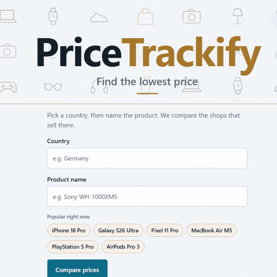
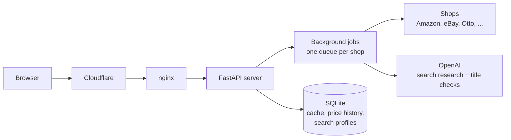

# PriceTrackify

**Finds the lowest price for a product across 39 shops in 22 countries.**
Live: [pricetrackify.com](https://pricetrackify.com)

## What it does

- Pick a country and type a product, e.g. "iPhone 18 Pro" or "galaxy a57 256gb black".
- Every shop that sells in that country is searched live: Amazon (22 countries), eBay (13 countries), and in Germany also Otto, MediaMarkt, Galaxus and Zalando.
- Each shop shows its cheapest offer that really is the searched product: not a case for it, not a spare part, not a similar model.
- Results appear shop by shop, cheapest first. Searches from the last 24 hours come back instantly.

## Architecture

## Key decisions

**AI matching instead of keyword matching.**
Problem: shop results for "Galaxy A57" are full of cases, screen protectors and other models.
Decision: an AI model reads every product title and compares type, brand, model and the options the user typed.
Result: a "phone case for the Galaxy A57" never counts as a Galaxy A57.

**Research profile, memory first.**
Problem: new products (newer than the AI's training data) were misunderstood.
Decision: each search phrase is researched once into a product profile (model, other names, the details that separate it from similar models). The AI answers from memory first and uses web search only when it doesn't know the product. The profile is stored, so each phrase is researched only once.
Result: correct profiles for brand-new products, at low cost.

**Price check against the other shops.**
Problem: a title can look right but be wrong, e.g. a €25 case listed in the phone category, or a single earbud sold as "AirPods Pro 3".
Decision: a result far below the median price of the other shops gets one extra AI check: is this the complete product?
Result: these fake "cheapest" offers are skipped; nothing is rejected by price alone.

**Lightweight requests instead of a full browser.**
Problem: opening a real browser for every search was slow and memory-hungry on a small server.
Decision: lightweight requests by default; a real browser only as a fallback.
Result: an Amazon search went from 26–46 s to 5–6 s.

**Background jobs.**
Problem: Cloudflare cuts every request after 100 s, and some shop searches wait longer in the queue.
Decision: the server answers at once with a ticket; the page asks for the result every 2 s. Each shop has its own queue, and a search checks the cache again when its turn comes.
Result: no cut-off searches; several people searching the same new product cause only one live search per shop.

**Abuse protection that normal users never notice.**
Problem: a free, AI-powered site can be flooded by scripts.
Decision: a short cooldown for new products per visitor (the page waits by itself), a temporary block for scripts, and an email alert when AI spending rises unusually.
Result: no visible limits for normal users.

**Daily self-test.**
Problem: shops change their pages without notice.
Decision: every morning each of the 39 shops gets one live test search; any problem sends an email.
Result: breakages are found before visitors find them.

**Privacy by design.**
No account, no cookies, no tracking. Fonts and icons are served by the site itself, so visitors' browsers never contact Google. Server logs are deleted after 30 days at the latest.

## Testing

Matching changes are tested offline before they go live: 644 saved shop titles from 12 searches, each labeled with the correct answer, are run through the real matching code.
Current result: 599 of 603 titles correct, 37 of 39 final picks correct.
A change goes live only if it improves this score and makes nothing worse.

## Tech stack

Python, FastAPI, SQLite, OpenAI API, nginx, Cloudflare, Hetzner (Ubuntu).

## Status

Work in progress: Germany first, Amazon and eBay in more countries.
Planned: price history charts and a new/used filter.

## Code access

The source code is private. It is available on request:
[LinkedIn](https://www.linkedin.com/in/sinafakhour) · fakhour.sina@gmail.com
